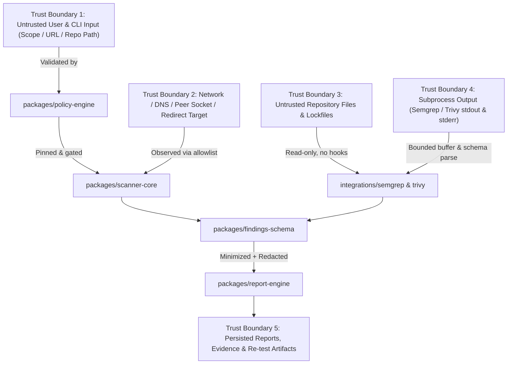

# HegoSentinel — Threat Model (Stage 0 / v0.1)

**Version:** 1.0.0 · **Date:** 2026-11-04 · **Status:** Enforced baseline for Stage 0 and Stage 1

## 1. System overview and security objective

HegoSentinel is a developer-first security assessment, evidence normalization, remediation guidance, and re-test comparison workflow. Because a security scanner processes untrusted target inputs, untrusted network responses, untrusted source repositories, and sensitive security observations, **the scanner itself is a high-value attack surface**.

Core security invariants:
1. **No authorization $\rightarrow$ no scan (`SEC-001`):** Every scan requires a valid, unexpired, strongly-typed authorization grant with explicit asset boundaries and written permission reference.
2. **No safe egress $\rightarrow$ no remote scan (`SEC-002`..`SEC-005`):** Application-level URL validation is paired with DNS A/AAAA validation, IP pinning, socket peer verification, redirect containment, and mandatory network-layer egress isolation before remote targets are enabled.
3. **No arbitrary code execution (`SEC-006`):** Source and dependency scans treat repositories as untrusted data. No `npm install`, `composer install`, `postinstall` hooks, build scripts, or shell-interpolated commands are ever executed.
4. **Collection minimization and redaction (`SEC-007`):** Sensitive values (`Cookie`, `Set-Cookie` values, `Authorization`, JWTs, query secrets, raw HTTP bodies) are excluded at observation collection time and scrubbed again by the redaction engine before report emission.
5. **Truthful coverage and re-test semantics (`SEC-008`, `SEC-009`):** Missing tools, timeouts, or network errors produce `skipped` or `failed` coverage (`completed_with_gaps`), never a false "clean/secure" status. Incomparable runs produce `not_comparable`, never automatic `fixed`.

---

## 2. Trust boundaries

---

## 3. Threat catalog and mitigations (STRIDE)

| Threat ID | Category | Attack vector / failure mode | Mitigation control | Verification test |
| :--- | :--- | :--- | :--- | :--- |
| **TM-01** | Elevation of Privilege / Unauthorized Scanning | User supplies third-party domain, wildcard `*.example.com`, expired grant, or domain-control proof without written test authorization. | `policy-engine` requires explicit `written_permission_ref`, non-expired `expires_at`, active `time_window`, exact hostname/scheme/port, and `GET`/`HEAD` method allowlist. | `SEC-001` |
| **TM-02** | Server-Side Request Forgery (SSRF) | Target URL points to loopback (`127.0.0.1`, `::1`), RFC1918 private networks, link-local / cloud metadata (`169.254.169.254`, `fd00:ec2::254`), IPv4-mapped IPv6 (`::ffff:169.254.169.254`), or integer/octal IP literals. | Canonical URL parser rejects IP literals, credentials, and non-HTTP(S) schemes; `isDisallowedIpAddress` blocks all non-global IPv4/IPv6 ranges. | `SEC-002` |
| **TM-03** | Open Redirect Scope Escape | Authorized endpoint responds with `301`/`302`/`307`/`308` to an internal IP or out-of-scope third-party domain. | Automatic redirect following is disabled. Every redirect target is validated against scope and IP policy before logging; out-of-scope redirects are recorded as observations and not followed. | `SEC-003` |
| **TM-04** | DNS Rebinding (TOCTOU) | Attacker DNS returns a public IP during validation and rebinds to `127.0.0.1` or `169.254.169.254` when the socket connects. | `policy-engine` resolves all A/AAAA records, rejects if any candidate is non-global, pins the validated IP for the request, and verifies the connected socket peer address. Remote scanning also requires network-layer egress enforcement (`HSR-01`). | `SEC-004`, `SEC-005` |
| **TM-05** | Arbitrary Code Execution via Scanned Repository | Malicious repository includes `.git/hooks`, `package.json` `postinstall` scripts, shell metacharacters in filenames, or rogue binaries. | Adapters use `execFile` (`shell: false`) with binary allowlist, stripped environment, bounded output buffers, and never invoke package managers or repository scripts. | `SEC-006` |
| **TM-06** | Credential & Secret Leakage in Reports | Target responses or URLs contain session cookies, `Authorization: Bearer ...` tokens, API keys, or query tokens (`?token=...`). | Observers never collect cookie values or raw bodies (`HSR-06`); `report-engine` enforces field allowlists and multi-pass regex/key/entropy redaction plus Markdown/HTML escaping. | `SEC-007` |
| **TM-07** | False Assurance from Silent Scanner Failure | Trivy/Semgrep is not installed, crashes, or times out, resulting in 0 findings interpreted as "secure". | Adapter statuses (`executed`, `skipped`, `failed`) roll up into mandatory report `coverage` metadata (`completed_with_gaps` or `failed`). | `SEC-008` |
| **TM-08** | False Fix Claim in Re-test | Second scan runs with a narrower scope, different rule version, or failed check and no longer sees the finding. | `recheck-engine` verifies scope, asset, profile, rule version, and check execution comparability before marking `no_longer_observed` or `verified_fixed`; mismatches emit `not_comparable`. | `SEC-009`, `SEC-010` |
| **TM-09** | Unintended External Network Traffic in Offline Mode | Offline demo or CI test accidentally contacts external DNS or HTTP endpoints. | Offline mode locks the runner to in-memory synthetic fixtures and blocks socket creation. | `SEC-014` |

---

## 4. Residual risks and Stage 2/3 requirements

- **Application-only filtering cannot replace OS/container firewalling (`HSR-01`):** Therefore, remote target scanning is **fail-closed (disabled by default)** in v0.1 unless explicit egress sandbox verification is provided alongside passing policy checks.
- **Multi-tenant isolation (`HSR-08`):** Although `organization_id` and `project_id` are enforced in all v0.1 schemas and fingerprints, full database RBAC, worker node separation, and signed artifact URLs belong to Stage 2 (`v0.2`).

