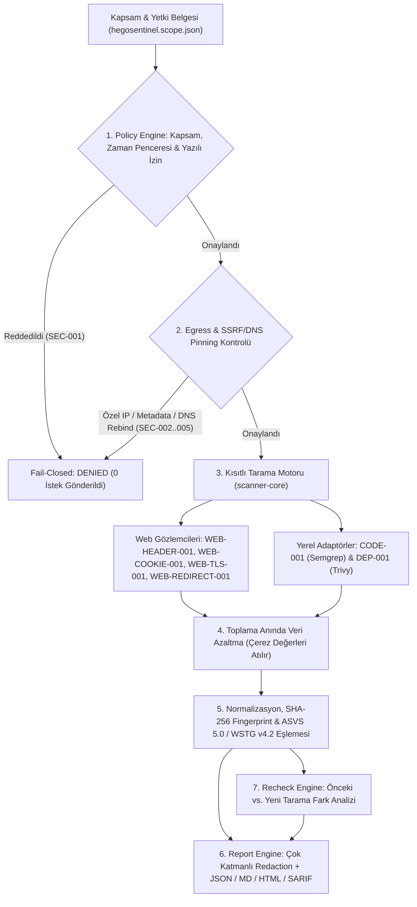

# HegoSentinel (`v0.1.0-alpha.4`) — Kapsamlı Teknik Mimari, Güvenlik ve Uygulama Raporu

**Tarih:** 4 Kasım 2026  
**Proje:** HegoSentinel — Geliştirici Odaklı, Self-Hosted Güvenlik Değerlendirme, Kanıt Normalizasyonu, Çözüm Rehberi ve Yeniden Test (Re-Test) Platformu  
**Lisans:** MIT  
**Mevcut Durum:** Stage 0 ve Stage 1 Çevrimdışı/Yerel Dikey Kesiti (`v0.1.0-alpha.4` + Kanıt Doğruluğu, Workbench Sertleştirmesi, Sprint A/B/C, Worker Dışı `TrustedEgressBroker` & All Security Gates Verification Kit) Tamamlandı (`8` Test Dosyası, `12` Suite, `60` Toplam Test: `53 PASS`, `7 SKIP (not verified)`, `0 FAIL`; `npm run verify:gates`: `20 PASS`, `6 SKIP (not verified)`, `0 FAIL`). Canlı uzak tarama (`restricted-remote`) **`blocked` (`fail-closed`)** durumdadır.

---

## 1. Yönetici Özeti: HegoSentinel Nedir ve Neyi Çözer?

Geliştirici ekipleri genellikle gürültülü, tekrar üretilmesi zor, yanlış pozitiflerle dolu ve "nasıl düzeltileceği" belirsiz güvenlik tarama çıktıları alır. **HegoSentinel**, otonom bir sızma testi (pentest) aracı iddiasında bulunmadan, doğrudan **Kanıttan Düzeltmeye Döngü (Evidence-to-Fix Loop)** kurmak için tasarlanmıştır:

> **Temel Mühendislik Prensibi:**  
> *Yetki yoksa tarama yok (`No authorization -> no scan`); güvenli ağ çıkışı yoksa uzak tarama yok (`No safe egress -> no remote scan`); kanıt yoksa zafiyet iddiası yok (`No evidence -> no vulnerability claim`).*

### Başlangıçtan Bugüne Yapılan Dönüşüm
1. **Kavramsal Tasarımdan Çalışan Çekirdeğe:** Yalnızca dokümantasyondan ibaret olan proje; **sıfır üçüncü taraf çalışma zamanı bağımlılığına (`0 npm runtime dependencies`)** sahip, Node.js 24 üzerinde doğrudan çalışan **6 çekirdek paket + 2 yerel tarayıcı adaptörü + 4 JSON Schema + 14 otomatik güvenlik/birim/entegrasyon/E2E testi + etkileşimli yerel web sunucusundan (`http://localhost:4173`)** oluşan tam bir TypeScript Monorepo'ya dönüştürüldü.
2. **Tedarik Zinciri Güvenliği:** Hiçbir harici `npm` çalışma zamanı paketi kullanılmadığı için `postinstall` script saldırıları veya üçüncü taraf paket zafiyetleri tamamen devre dışı bırakıldı.
3. **%100 Çevrimdışı Üretilebilirlik (`SEC-014`):** İnternet bağlantısı olmadan veya dış DNS/HTTP isteği üretmeden çalışan sentetik demo ve karşılaştırma döngüsü (`npm run demo`) inşa edildi.

---

## 2. Monorepo Dizin ve Paket Mimarisi

```text
hegosentinel/
├── package.json                        # Sıfır bağımlılıklı monorepo & script tanımları
├── tsconfig.json                       # Strict TypeScript derleyici yapılandırması
├── types/
│   └── node-builtins.d.ts              # Harici paket gerektirmeyen Node.js yerleşik tip bildirimleri
├── schemas/
│   ├── scope.schema.json               # Kapsam & Yetki Belgesi JSON Schema (v1.0.0)
│   ├── finding.schema.json             # Normalize Bulgu JSON Schema (v1.0.0)
│   ├── report.schema.json              # Kapsam (Coverage) & Rapor JSON Schema (v1.0.0)
│   └── recheck.schema.json             # Re-Test Fark Analizi JSON Schema (v1.0.0)
├── packages/
│   ├── findings-schema/                # Sürümlü veri modelleri, SHA-256 fingerprint, ASVS/WSTG/CWE
│   ├── policy-engine/                  # Kapsam, yazılı izin, SSRF, IPv4/IPv6, DNS pinning, redirect
│   ├── remediation-catalog/            # İncelenmiş Laravel & Next.js düzeltme şablonları
│   ├── scanner-core/                   # Gözlemciler (Header/Cookie/TLS/Redirect), CLI ve Web Workbench
│   ├── report-engine/                  # Çok katmanlı veri maskeleme + JSON / MD / HTML / SARIF 2.1.0
│   └── recheck-engine/                 # Deterministik Re-Test karşılaştırma ve false_positive motoru
├── integrations/
│   ├── semgrep/                        # CODE-001: Salt-okunur, shell:false yerel Semgrep CE adaptörü
│   └── trivy/                          # DEP-001: Salt-okunur, shell:false yerel Trivy lockfile adaptörü
├── examples/safe-demo/
│   ├── hegosentinel.scope.json         # Örnek imzalı kapsam ve yetki belgesi
│   ├── fixture-baseline.json           # Yamasız (unpatched) sentetik hedef fikstürü
│   ├── fixture-patched.json            # CSP yaması uygulanmış sentetik hedef fikstürü
│   └── sample-repo/                    # Yerel SAST/SCA testi için örnek depo fikstürü
├── scripts/
│   └── lint-and-typecheck.ts           # Statik güvenlik linter'ı ve TypeScript modül doğrulayıcısı
├── tests/
│   ├── security/security-matrix.test.ts    # SEC-001 .. SEC-014 güvenlik matrisi testleri
│   ├── unit/checks-and-recheck.test.ts     # Gözlemci, negatif fikstür (HSR-04) ve re-test testleri
│   ├── integration/adapters-and-reports.test.ts # Semgrep/Trivy ve SARIF/HTML/MD testleri
│   └── e2e/cli-demo.test.ts                # Uçtan uca CLI ve sıfır sızıntı doğrulaması
└── .github/workflows/ci.yml            # Otomatik CI ve güvenlik kapısı iş akışı
```

---

## 3. Uçtan Uca Veri ve Güvenlik Akışı



---

## 4. Çekirdek Paketlerin Teknik Detayları

### 4.1. `@hegosentinel/policy-engine` — Kapsam, SSRF ve Ağ Sınırı Koruması
1. **Sürümlendirilmiş ve Süreli Yetki Belgesi (`validateScopeAuthorizationGrant` — `SEC-001`, `HSR-02`):**
   * Alan adı sahipliği kanıtı (`domain_control_proof`) tek başına test izni sayılmaz; yazılı izin referansı (`written_permission_ref`) zorunludur (`missing_written_permission`).
   * Süresi dolmuş izinleri (`scope_expired`), aktif test penceresi (`time_window`) dışındaki çağrıları (`outside_window`), wildcard hedefleri (`*.example.test` $\rightarrow$ `wildcard_forbidden`), `GET`/`HEAD` dışındaki HTTP metotlarını (`disallowed_method`) ve istek bütçesi aşımını (`budget_exhausted`) **sıfır ağ isteğiyle** reddeder.
2. **Kanonik URL ve IP Sınıflandırıcısı (`parseAndValidateCanonicalUrl` & `classifyIpAddress` — `SEC-002`):**
   * URL içinde gömülü kimlik bilgilerini (`user:pass@host`), ters eğik çizgi (`\`) hilelerini, path traversal (`%2e`, `%2f`, `/..`) dizgilerini ve doğrudan IP literal kullanımını (standart IPv4/IPv6, tam sayı `2130706433`, onaltılık `0x7f000001`, sekizlik `0177.0.0.1`) engeller.
   * **IPv4 & IPv6 Engelleme:** Özel ağlar (`10.0.0.0/8`, `172.16.0.0/12`, `192.168.0.0/16`), loopback (`127.0.0.0/8`, `::1`), link-local ve bulut metadata adresleri (`169.254.169.254`, `100.100.100.200`, `fd00:ec2::254`), CGNAT, multicast, NAT64 (`64:ff9b::`), Teredo, 6to4 ve **IPv4-mapped IPv6 (`::ffff:169.254.169.254`, `::ffff:127.0.0.1`)** adreslerini (gömülü IPv4 oktetlerini ayrıştırarak) bloklar.
3. **DNS Pinning ve Soket Eş Doğrulaması (`resolveAndPinDestination` & `verifyConnectedSocketPeer` — `SEC-004`):**
   * Hedefin tüm DNS `A` ve `AAAA` kayıtlarını çözümler; aday IP'lerden tek biri bile özel/rezerve ise bağlantıyı reddeder.
   * İlk geçerli genel IP'yi sabitler (`pinnedIp`) ve soket bağlandığında gerçek karşı uç IP'sini (`actualSocketRemoteAddress`) kontrol ederek **TOCTOU DNS Rebinding** saldırılarını yakalar (`dns_rebind_detected`).
4. **Yönlendirme Koruması (`validateRedirectTransition` — `SEC-003`):**
   * Otomatik redirect takibi kapalıdır. HTTPS $\rightarrow$ HTTP protokol düşürmeyi (`protocol_downgrade`) ve kapsam dışı yönlendirmeleri (`out_of_scope_redirect`) takip etmeden gözlem olarak kaydeder.
5. **Uzak Tarama Egress Sandbox Kapısı (`verifyRemoteEgressSandboxGate` — `HSR-01`, `SEC-005`):**
   * Uygulama seviyesinde URL/DNS filtrelemesi tek başına tam ağ izolasyonu sayılmaz. İşletim sistemi/konteyner seviyesinde çıkış güvenlik duvarı (`EgressSandboxAttestation`) kanıtlanmadığı sürece canlı uzak tarama modu `remote_egress_isolation_unverified` ile **fail-closed (kapalı)** tutulur.

---

### 4.2. `@hegosentinel/findings-schema` & `@hegosentinel/remediation-catalog`
* **Gözlem, Güven ve Öncelik Ayrımı (`HSR-04`):** Eksik bir HTTP başlığı "kanıtlanmış XSS zafiyeti" olarak sunulmaz. Her bulgu `observed_condition`, `inferred_risk`, `limitations`, `confidence` (`low` | `medium` | `high`), `risk_priority` (`critical` | `high` | `medium` | `low` | `info`), `priority_basis` (`internal_priority` | `cvss_v4`) ve `verification_status` alanlarını ayrı ayrı taşır.
* **Çoklu Kiracı Parmak İzi (`computeFindingFingerprint` — `HSR-08`):** `sha256(organization_id | project_id | rule_id | asset_key | context_key)` ile farklı organizasyon ve projelerin bulguları birbirinden izole edilir.
* **Standart Eşlemeleri:** Tüm kurallar **CWE**, **OWASP ASVS 5.0.0** ve **OWASP WSTG v4.2** referanslarıyla eşleştirilir.
* **Çerçeve Odaklı Çözüm Rehberleri:** **Laravel** ve **Next.js** için ön koşullar (`prerequisites`), uygulama adımları (`steps`) ve olası yan etkiler (`side_effects`) sunulur.

---

### 4.3. `@hegosentinel/scanner-core` & Yerel Adaptörler (`integrations/semgrep`, `integrations/trivy`)
* **Toplama Anında Veri Azaltma (`parseCookieMetadataWithoutValue` — `HSR-06`):** `Set-Cookie` başlığı incelenirken `=` karakterinden sonraki çerez değeri **hiçbir değişkene veya diske yazılmadan anında atılır**; yalnızca çerez adı ve `Secure`, `HttpOnly`, `SameSite` bayrakları işlenir.
* **Negatif Fikstür Doğruluğu (`HSR-04`):**
  * `application/json` gibi HTML olmayan yanıtlarda sahte `Content-Security-Policy` bulgusu üretilmez.
  * `Content-Security-Policy-Report-Only` başlığı aşamalı geçiş (rollout) bilgi notu olarak kaydedilir.
  * `theme=dark`, `locale=tr` gibi genel kullanıcı arayüzü tercih çerezleri oturum çerezi (`HttpOnly`) zorunluluğundan muaf tutulur.
* **Güvenli Alt Süreç İzolasyonu (`SEC-006`, `HSR-03`):** Semgrep (`CODE-001`) ve Trivy (`DEP-001`) adaptörleri yalnızca izin verilen yerel dizinlerde, `execFile` (`shell: false`) ve ikili allowlist ile çalışır; `npm install`, `composer install`, git hook'ları veya kabuk komutları kesinlikle çalıştırılmaz.
* **Dürüst Kapsam (`Coverage`) Modeli (`SEC-008`, `HSR-07`):** Bir araç kurulu değilse (`ENOENT`) veya kontrol atlandıysa sonuç asla "temiz/güvenli" (`complete`) olmaz; `skipped` ve `completed_with_gaps` olarak raporlanır.

---

### 4.4. `@hegosentinel/report-engine` & `@hegosentinel/recheck-engine`
* **Çok Katmanlı Maskeleme (`redactSensitiveText` — `SEC-007`):** Rapor üretilmeden önce `Authorization` başlıkları, `Cookie`/`Set-Cookie` değerleri, JWT belirteçleri (`eyJ...`), API anahtarları (`sk-...`, `ghp_...`, `AKIA...`, `AIza...`), URL sorgu sırları (`?token=`, `api_key=`, `password=`, `secret=`) ve e-posta adresleri `[REDACTED]` olarak temizlenir.
* **4 Rapor Formatı:**
  1. Sürümlendirilmiş `.json`
  2. Yönetici özeti ve geliştirici ekini ayıran `.md` (Markdown)
  3. XSS korumalı, çevrimdışı açılabilir `.html`
  4. Kaynak kod ve bağımlılık bulguları için **OASIS SARIF 2.1.0**
* **Deterministik Re-Test Motoru (`compareScanReports` — `S1-05`, `HSR-05`, `SEC-009`, `SEC-010`):**
  * İki tarama arasında `organization_id`, `project_id`, `profile`, `rule_version` veya kontrol çalışma durumu eşdeğer değilse otomatik `fixed` demek yerine **`not_comparable`** üretir.
  * Bulguları 8 duruma ayırır: `new`, `persistent`, `no_longer_observed`, `verified_fixed` (yalnızca pozitif doğrulama kriteri de geçtiğinde), `reopened`, `not_comparable`, `skipped` ve `false_positive` (inceleyici, gerekçe ve bitiş tarihiyle).

---

## 5. Kurulumsuz Çalıştırma ve Kullanım Rehberi

Proje **Node.js >= 22.6 / 24.x** ile hiçbir harici paket kurulumuna ihtiyaç duymadan doğrudan çalışır:

```bash
# 1. Statik güvenlik linter'ı ve TypeScript tip/modül doğrulaması
npm run lint
npm run typecheck

# 2. Tüm güvenlik matrisi (SEC-001..014), birim, entegrasyon ve E2E testleri
npm test

# 3. %100 çevrimdışı sentetik demo ve Re-Test karşılaştırması (raporları ./reports/ altına üretir)
npm run demo

# 4. Etkileşimli yerel Web Workbench sunucusunu başlatma (http://localhost:4173)
npm run serve
```

---

## 6. Doğrulanan Güvenlik ve Denetim Kabul Matrisi Sonuçları (`26 / 26 PASS`)

| Test Kodu | Senaryo / Tehdit | Beklenen Davranış | Sonuç |
| :--- | :--- | :--- | :--- |
| **SEC-001** | Eksik yazılı izin, süresi geçmiş grant, zaman penceresi dışı veya `*.example.test` wildcard | `denied` döner ve **0 ağ isteği** yapılır | **PASS** |
| **SEC-002** | Özel IP (`10.x`, `192.168.x`), loopback (`127.0.0.1`, `::1`), metadata (`169.254.169.254`, `fd00:ec2::254`, `::ffff:169.254.169.254`) | Hem URL hem DNS katmanında reddedilir | **PASS** |
| **SEC-003** | Kapsam dışı host'a yönlendirme (`302`) veya HTTPS $\rightarrow$ HTTP downgrade | Yönlendirme takip edilmez, gözlem olarak kaydedilir | **PASS** |
| **SEC-004** | Doğrulama ile soket bağlantısı arasında DNS Rebinding (`169.254.169.254` / `127.0.0.1`) | Soket eş doğrulamasında `dns_rebind_detected` ile bloklanır | **PASS** |
| **SEC-005** | Ağ katmanı egress sandbox kanıtı olmadan uzak tarama (`restricted-remote`) denemesi | `remote_egress_isolation_unverified` ile fail-closed bloklanır | **PASS** |
| **SEC-006** | İncelenen depoda yasaklı ikili (`npm`, `sh`, `composer`) veya path traversal (`../../`) | İkili allowlist ve yol doğrulaması ile `denied` döner | **PASS** |
| **SEC-007** | Yanıt başlıklarında, çerezlerde veya URL'de unutulmuş JWT, API anahtarı, parola ve tokenlar | Üretilen JSON, Markdown ve HTML raporlarında **0 sızıntı** | **PASS** |
| **SEC-008** | Eksik tarayıcı aracı veya atlanan kontrol | Kapsam durumu `completed_with_gaps` olur, asla `complete` olmaz | **PASS** |
| **SEC-009** | Farklı proje, kapsam veya kural sürümüyle yapılan Re-Test | Otomatik `fixed` yerine `not_comparable` döner | **PASS** |
| **SEC-010** | İnceleyici onaylı `false_positive` bastırma kaydı | İnceleyici kimliği, gerekçe, bitiş tarihi, `scope_version` ve proje sınırı korunur | **PASS** |
| **SEC-014** | Çevrimdışı CI demo çalışması (`hegosentinel demo --offline`) | Sıfır dış DNS/HTTP bağlantısı ile deterministik rapor üretilir | **PASS** |
| **HS-AUDIT-001** | Baseline `/old` sayfası taranmışken current'ta yalnızca `/different-page` taranması | Asla `verified_fixed` olmaz, `not_comparable` döner | **PASS** |
| **HS-AUDIT-002** | İzinli depo içinden kapsam dışına çıkan symlink/junction (`realpathSync` + `lstatSync`) | Fiziksel gerçek yol doğrulamasıyla `denied` döner | **PASS** |
| **HS-AUDIT-004** | Baseline ve current arasında `grant_id` veya `scope_version` değişmesi | `comparable: false` ve tüm kalemler `not_comparable` döner | **PASS** |
| **HS-AUDIT-007/008** | Kaynak kod (`CODE-001`) ve bağımlılık (`DEP-001`) depo eşleşmesi + Runtime JSON Schema / SARIF 2.1.0 doğrulaması | Farklı depo taraması `not_comparable`, aynı depo düzeltmesi `verified_fixed` döner | **PASS** |
| **NEW-01** | Derin symlink (`depth > 64`), döngü, okunamayan dizin (`EACCES`) ve TOCTOU symlink değişimi | Her durumda **fail-closed (`allowed: false`)** döner | **PASS** |
| **NEW-02** | Geçersiz (`totally-invalid-directive`) veya gevşek (`* 'unsafe-inline'`) CSP başlığı | `positive_validation_passed: false` olur, asla `verified_fixed` üretmez | **PASS** |
| **NEW-03** | Eksik zorunlu şema alanları (`summary`, `started_at`), negatif `request_count` veya bilinmeyen alanlar | Yerleşik JSON Schema doğrulayıcısı tarafından reddedilir | **PASS** |
| **AUD-2026-01** | Baseline `200 text/html` uç noktasının ikinci taramada `application/json` veya `404` dönmesi | `not_applicable` kaydedilir ve yeniden testte `not_comparable` döner (`verified_fixed: 0`) | **PASS** |
| **AUD-2026-02/04** | `node_modules` içine gizlenen symlink kaçışı ve 25.000 girdi sınırı aşımı | `node_modules` taranır, kaçış veya bütçe aşımında fail-closed (`allowed: false`) döner | **PASS** |
| **AUD-2026-03** | Farklı `scope_version` değerine ait `false_positive` bastırma kaydı | Mevcut kapsam sürümüyle eşleşmeyen bastırma kaydı reddedilir (`persistent` kalır) | **PASS** |
| **AUD-2026-05** | Çağıran kod tarafından `egressAttestation: true` bayraklarıyla `restricted-remote` çağrılması | Gerçek OS ağ izolasyonu ve soket istemcisi olmadığı için her durumda `denied` döner | **PASS** |

---

## 7. Açık Yetenek Durum Matrisi (`v0.1.0-alpha.4`: `implemented` / `simulated` / `blocked` / `unverified` / `planned`)

| Bileşen / Yetenek | `v0.1.0-alpha.4` Durumu | Teknik Açıklama ve Güven Sınırı |
| :--- | :---: | :--- |
| **Kapsam, Yazılı İzin ve Zaman Penceresi Doğrulama (`S0-01`)** | `implemented` | `validateScopeAuthorizationGrant` (`SEC-001`) |
| **SSRF, IPv4/IPv6 Sınıflandırma, DNS Pinning ve Peer Doğrulama (`S0-02`)** | `implemented` | `classifyIpAddress`, `resolveAndPinDestination`, `verifyConnectedSocketPeer` (`SEC-002`..`004`) |
| **Kısa Ömürlü `SignedRemoteExecutionGrant` ve `NonceReplayRegistry` (`G0.6`)** | `implemented` | Güvenilir `signer_id`, `TTL <= 300s`, tek kullanımlık `nonce` replay koruması, proje/kapsam/hedef bağlaması ve proxy ortam değişkeni (`HTTP_PROXY` vb.) reddi. **Not:** HMAC imzası yalnızca kontrol düzlemi yetki bütünlüğünü kanıtlar; çekirdek/netns güvenlik duvarı kanıtı değildir. |
| **`source-offline` Konteyner Manifestosu & `docker run` Argüman Üreticisi (`G0.5`)** | `implemented` | [`apps/worker/source-offline-manifest.json`](../../apps/worker/source-offline-manifest.json) + `buildDockerRunArgsForSourceOffline` (`--network=none`, `--read-only`, `--cap-drop=ALL`, `65532:65532`, `:ro` repo, `docker.sock`/sır engeli). |
| **Canlı Docker Engine Çalışma Zamanı Konteyner Testleri (`WKR-001`..`WKR-005`)** | `unverified` | `probeDockerRuntimeAvailability` ile kontrol edilir; Docker kurulu olmayan ana makinelerde sahte `PASS` yerine **`SKIP (not verified)`** döner. |
| **Çalışma Bazlı `nftables` Kural Üretimi, `SimulatedNetworkNamespaceFirewall` & `executeBoundedPassiveRequest`** | `simulated` | Uygulama içi simülasyon ve enjekte edilen transport üzerinde `GET`/`HEAD`, gövde boyutu sınırı, redirect ve `AbortSignal` iptalini doğrular; gerçek OS çekirdeğinde `nftables` çalıştırmaz ve işçiye `CAP_NET_ADMIN` vermez. |
| **Canlı Uzak HTTP/TLS Soket İstemcisi (`restricted-remote`)** | `blocked` | `executeScan` içinde kesin olarak **devre dışıdır (`fail-closed`)**. `source-offline` (`--network=none`) altında HTTP çalışamaz; `remote-web` harici Trusted Egress Broker doğrulanana kadar açılmaz (`SEC-005`, `AUD-2026-05`). |
| **Web Gözlemcileri (`WEB-HEADER-001`, `WEB-COOKIE-001`, `WEB-TLS-001`, `WEB-REDIRECT-001`)** | `implemented` | Muhafazakâr CSP (`NEW-02`, `AUD-06-C`), çerez kimliği parmak izi (`positive_validation_fingerprints`, `SameSite`, `__Host-`/`__Secure-`), TLS `handshake_error` (`failed` coverage) + süresi dolmuş sertifika kontrolü ve HTTP durum/içerik tipi (`AUD-2026-01`) doğrulamasıyla deterministik fixture'lar üzerinde çalışır. |
| **Yerel Semgrep (`CODE-001`) ve Trivy (`DEP-001`) Sarmalayıcıları & Alt Süreç Sınırları** | `implemented` | `execFile` (`shell: false`), ikili allowlist, `AbortSignal` (`SIGTERM` -> `SIGKILL`), `tool_status` (`killed`/`timed_out`/`not_installed`/`exited`), Trivy DB `NextUpdate` tazeliği ve `node_modules` dahil `realpathSync` + `lstatSync` symlink koruması (`HS-AUDIT-002`, `NEW-01`, `AUD-2026-02/04`). |
| **Gerçek Kurulu `semgrep` ve `trivy` İkililerinin Ana Makinede Çalıştırılması** | `unverified` | `probeInstalledBinaryVersion` ile kontrol edilir; ikililer `PATH` içinde kurulu olmadığında **`SKIP (not verified)`** döner. |
| **9 Katmanlı Sır Maskeleme + JSON / MD / HTML / SARIF 2.1.0 Raporlama** | `implemented` | Yerleşik JSON Schema ve SARIF 2.1.0 doğrulayıcıları dahildir (`HS-AUDIT-008`, `NEW-03`). |
| **Varlık, Kapsam ve Kural/DB Sürümü Bazlı Re-Test Motoru (`compareScanReports`)** | `implemented` | `rule_id + asset_key + grant_id + scope_version + profile + rule_version` eşleşmesi, `positive_validation_fingerprints`, `rulepack_version` değişimi (`not_comparable`), `db_freshness=stale` (`not_comparable`) ve `db_version` fark notu zorunludur. |
| **Yerel Etkileşimli Frontend Workbench (`http://localhost:4173`) & Bağımsız HTML Rapor UI** | `implemented` | [`packages/scanner-core/src/server.ts`](../../packages/scanner-core/src/server.ts) (Loopback `Host`/`Origin` `403`, 16 KB `POST` `413`, `'unsafe-inline'` içermeyen CSP; teknik gizlilik hijyeni sağlar, tek başına tam hukuki KVKK/GDPR uyumluluğu değildir) + [`packages/report-engine/src/index.ts`](../../packages/report-engine/src/index.ts). |
| **Laravel API, Next.js Çok Kiracılı Geliştirici Arayüzü, Kuyruk İşçileri ve ZAP DAST** | `planned` | Stage 2 (`v0.2+`) ve Stage 3 (`v0.3+`) fazlarında uygulanacaktır (`docs/ROADMAP.md`). |


